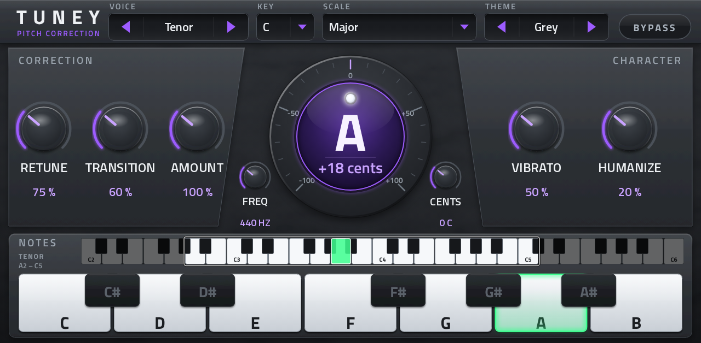

# Tuney

Real-time vocal pitch correction for Akai MPC OS standalone devices, as a native VST2 audio effect built with
[mpc-vst-plugins](https://github.com/sd88me/mpc-vst-plugins).



## What it does
- **Corrects pitch as you sing:**
  - Key and Scale (Chromatic, Major, Minor, Harmonic Minor, Major and Minor Pentatonic).
  - A **User** scale: tap the piano keys to choose exactly which notes it may land on.
- **Shows what you sing:**
  - The pitch dial gives the note and how many cents off it is.
  - The sung key lights on the one-octave piano, and its exact key and octave show on the four-octave range strip.
- **Shapes how it sounds:**
  - **Retune** (how hard notes are held), **Transition** (instant steps to slow slides between notes) and **Amount**.
  - **Vibrato** (keep or flatten it) and **Humanize** (long notes relax, short ones still snap).
- **Voice** range (Soprano, Alto, Tenor, Baritone) sets what it listens for and the latency (about 12 to 25 ms).
- **Reference pitch:** Freq (A4 in Hz) and Cents, for tracks not tuned to 440.
- Presets from hard tune to subtle in MPC's own preset menu, four colour themes, Q-Link pages and bypass. Pitch detection
  and correction keep the voice's formants and are light on CPU.

## Install
Download `Tuney-<version>-mpc-armv7.zip` from [Releases](../../releases). The zip's `INSTALL.md` has the requirements and steps.
The scripted install runs `install.sh` as root on the device, so it is for modded units. Gen1 devices (MPC Live/One/X/Key
61/Force); tested on an MPC Live II.

## Build
Needs a checkout of [mpc-vst-plugins](https://github.com/sd88me/mpc-vst-plugins) next to this one, and Docker.
```bash
MV=../mpc-vst-plugins
$MV/tools/test_port.sh vst/vst.json && $MV/tools/build_port.sh vst/vst.json
```
Engine tests and the on-device checklist are in [TESTING.md](TESTING.md). Release zips are built by GitHub Actions
(**Actions → Release → Run workflow**), which makes a draft release. The skin artwork is pre-drawn (`tools/make_skin_art.py` redraws it).

## License
MIT, see [LICENSE](LICENSE). The pitch detection (YIN) and correction (TD-PSOLA) are original code. The fonts used to draw
the skin come from mpc-vst-plugins (Titillium Web, SIL Open Font License).
